# RetroShell 3210 — Replacement Mainboard Concept

**Azure Dragon Tech · Independent hardware project**

## Support the Project

If you would like to support RetroShell 3210 and help fund the first hardware prototype, consider supporting the project on Ko-fi.

RetroShell 3210 is a concept for a modern replacement motherboard intended for the original Nokia 3210 (1999) enclosure. The goal is to preserve the familiar handset form factor while exploring updated electronics and a retro-style keypad interface.

> **Status: concept/design presentation.** These images are PCB renders, schematic overview and interface mockups. They do not demonstrate a manufactured or tested board. Features below are goals, not verified capabilities.

## PCB layout concepts

| Front-side layout | Rear-side layout |
|---|---|
| 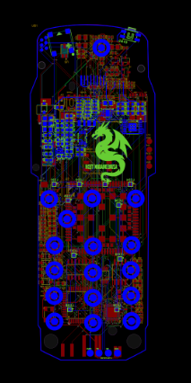 | 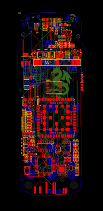 |

## 3D board renders

| Front | Rear |
|---|---|
| 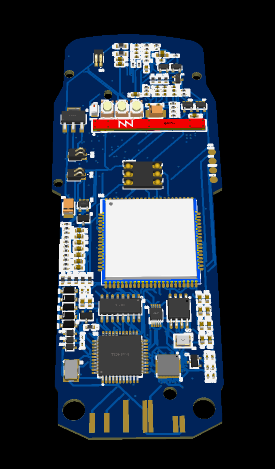 | 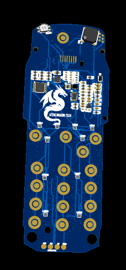 |

## Schematic overview

Fine labels and reference text have been blurred for presentation. This image communicates only the broad schematic layout.

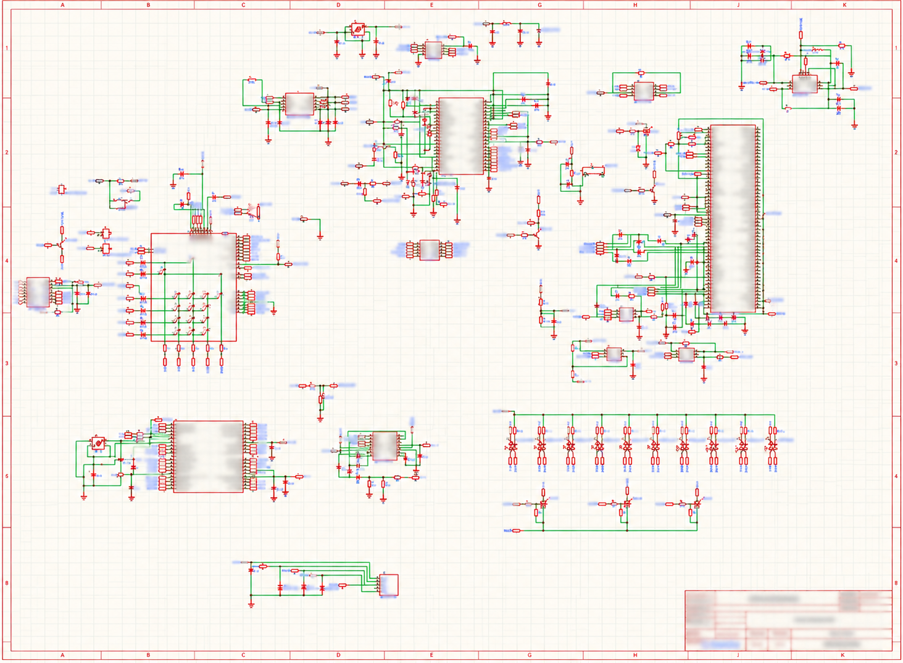

## UI / firmware direction

These are interface mockups, not proof of running firmware.

| Home menu | Messages menu |
|---|---|
| 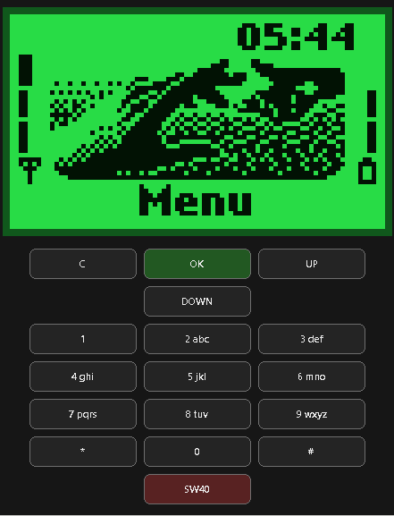 | 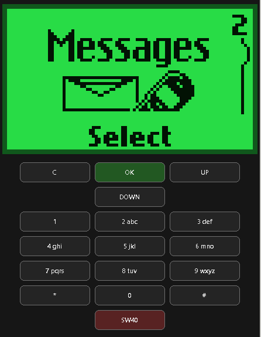 |

| Text entry | Loading screen |
|---|---|
| 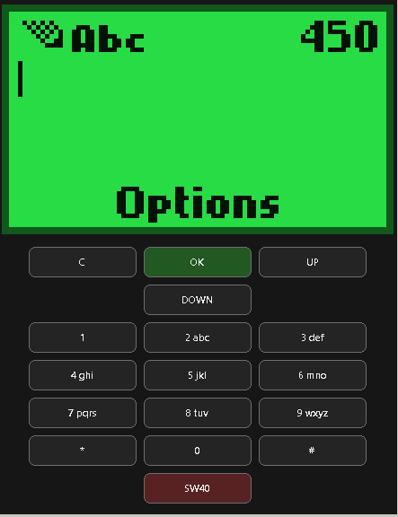 | 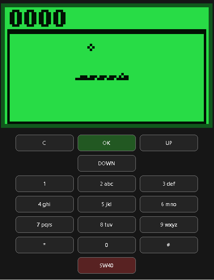 |

| Theme options | Theme options |
|---|---|
| 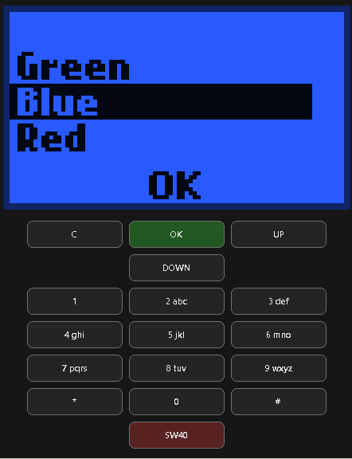 | 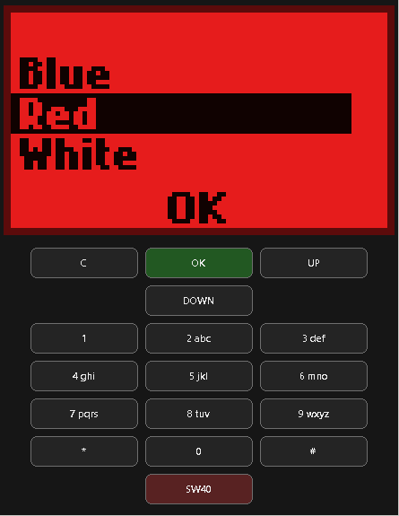 |

| Theme options | Custom theme |
|---|---|
| 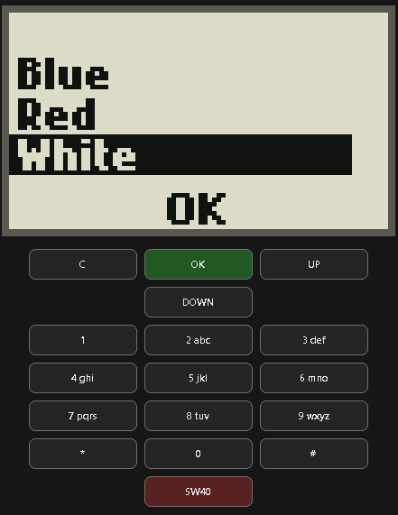 | 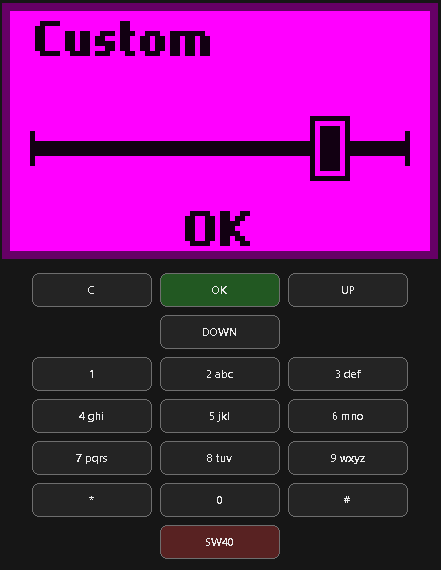 |

## Project goals

The intended feature direction follows the broader RetroShell 3310 concept, adapted to the Nokia 3210 form factor. Actual feasibility depends on component selection, enclosure measurements, antenna design, power budgeting, firmware development and testing.

Planned areas of investigation:
- Modern cellular connectivity, subject to modem support, regional bands and regulatory requirements.
- Bluetooth support for compatible audio accessories.
- Custom keypad-driven, retro-inspired menus.
- Display and keypad compatibility with the original handset.
- Selectable UI themes and possible backlight options, if supported by the chosen hardware.
- Retro-style games and a simple virtual-pet concept.
- Safe battery management, charging and low-power operation.

These are planned goals, **not confirmed specifications**. This repository should not be treated as a build-ready design until engineering files, bill of materials, electrical checks, mechanical fit checks and prototype test results are available.

## Current status

- [x] Concept imagery organised
- [x] PCB layouts and 3D renders included
- [x] UI mockups included
- [x] Schematic overview included with fine text obscured
- [ ] Confirm board dimensions and enclosure clearances
- [ ] Review schematic and component selection
- [ ] Validate battery charging and power safety
- [ ] Review cellular bands, antenna matching and regulations
- [ ] Manufacture and bring up a prototype
- [ ] Test calls, messaging, Bluetooth, display, keypad and battery life
- [ ] Publish verified specifications and test evidence

## Relationship to RetroShell 3310

RetroShell is intended as a family of model-specific concepts. This repository focuses on the **Nokia 3210 (1999)** form factor. The separate 3310 concept is at [Nokia-3310-4G-Azure-Dragon-Tech](https://github.com/jerydgreen-maker/Nokia-3310-4G-Azure-Dragon-Tech). Similar goals do not mean the boards, dimensions, components or firmware are interchangeable.

## Safety

This is a design presentation, not a tested consumer product or assembly guide. Cellular RF design, lithium-battery charging and power electronics require appropriate engineering review and testing. Do not connect a battery or power source to an unverified board.

## License

Unless a separate license is explicitly provided for a specific file or directory, materials in this repository are provided for viewing and informational purposes only. No permission is granted to reproduce, modify, redistribute, or use these materials commercially. See [LICENSE](LICENSE) for the full notice.

## Credits

Developed as an independent concept by **Azure Dragon Tech**.

Nokia and 3210 are trademarks of their respective owners. This project is unofficial and is not affiliated with, endorsed by, or sponsored by Nokia.
